# KimpScope — 김치 프리미엄 RAG

국내(업비트)와 해외 코인 가격 차이, 김치 프리미엄(김프)을 계산하고, **그 차이가 왜 생겼는지**를 거래소 공지·입출금 상태 근거로 설명하는 RAG 서비스입니다.

- 배포: https://kimpscope.onrender.com (Render 무료 플랜. 15분 이상 요청이 없으면 잠들어 첫 접속에 30초~1분 걸립니다)
- 과제: SSAFY AI 코어 프로젝트 2회차 — RAG 지식 서비스
- 셀프 체크리스트 결과: [docs/checklist/RESULTS.md](docs/checklist/RESULTS.md)

## 1. 왜 이 도메인인가

김프 수치 자체는 계산입니다. 국내 원화가 ÷ (해외 USDT가 × 원/달러 환율) − 1. RAG가 필요한 곳은 그 다음 질문입니다. "이 코인만 김프가 10%인 이유는?"에 답하려면 입출금 중지 공지, 거래소 경보, 네트워크 점검 같은 **문서 근거**가 필요하고, 모델 지식으로 답하면 틀립니다.

같은 이유로 가격·김프·입출금 상태 같은 **현재 값은 색인하지 않습니다.** 벡터 저장소에 넣는 순간 지난 값이 되기 때문입니다. 질문 시점에 조회해 기준 시각을 붙인 근거로 만들고, 문서 속 숫자를 현재 값으로 쓰지 못하게 막습니다.

## 2. 화면과 기능

아래 캡처는 2026-10-23 16:14~16:31 KST에 운영 서버(https://kimpscope.onrender.com)에서 셀프 점검을 하며 찍은 것입니다. 원본은 [docs/checklist/evidence/screenshots/](docs/checklist/evidence/screenshots/)에 있습니다. 08·09·10·11·13번 캡처의 "공식 문서" 패널에 보이는 "검색 서버 연결 후 문서를 확인할 수 있습니다" / "문서 목록 확인 중…"은 점검 중 발견한 화면 오류이고, 고친 뒤의 모습은 19번 두 번째 캡처입니다. 캡처 이후 공식 문서에 정부 보도자료 3건이 추가돼, 지금 문서 패널에는 캡처보다 많은 문서가 보입니다.

### 2-1. 김프 시세표 — 도메인 특화 기능 (F2010)

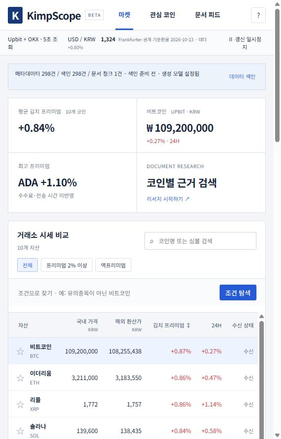

- 맨 위 줄에 시세 출처(Upbit + OKX, 5초 조회)와 환율 출처(Frankfurter 공개 기준환율, 고시일 2026-10-23)를 표시합니다. 바이낸스가 운영 서버 IP를 막아(418) OKX로 대체 중이라는 사실이 화면에 그대로 나옵니다.
- 상태 줄은 메타데이터 298건 / 색인 298건 / 문서 청크 수 / 생성 모델 설정 여부를 보여 주고, **데이터 색인** 버튼으로 색인을 다시 만들 수 있습니다(F2001·F2002·F2012).
- 요약 카드: 평균 김프(대표 10개 코인), 비트코인 원화가, 최고 프리미엄 코인. "수수료·전송 시간 미반영"을 함께 적습니다.
- 시세 비교표: 코인마다 국내 가격, 해외 환산가, 김치 프리미엄, 24시간 등락, 수신 상태. 전체 / 프리미엄 2% 이상 / 역프리미엄 필터와 이름·심볼 검색이 있습니다.

### 2-2. 자연어 조건 탐색 → 채팅 연결 (F2011)

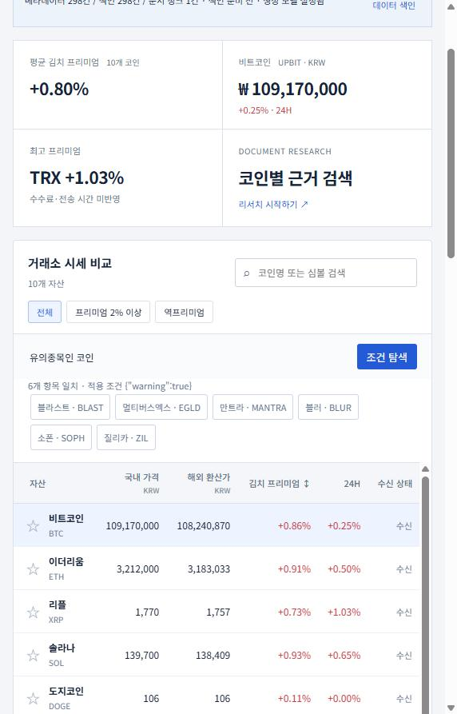 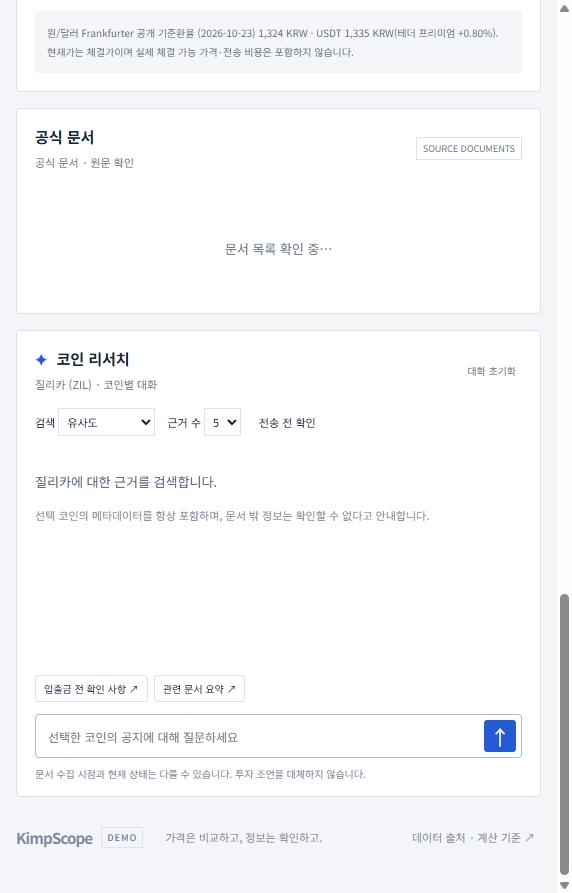

- "유의종목인 코인"을 입력하면 모델이 조건을 `{"warning": true}`로 해석하고, 그 조건으로 걸러낸 6개(BLAST·EGLD·MANTRA·BLUR·SOPH·ZIL)만 보여 줍니다. 적용한 조건을 화면에 그대로 표시해 조건에 맞지 않는 코인이 섞이지 않았는지 확인할 수 있습니다.
- 결과 칩(질리카·ZIL)을 누르면 오른쪽 캡처처럼 그 코인의 리서치 대화로 넘어갑니다.

### 2-3. 코인별 리서치 채팅과 근거 표시 (F2003~F2009)

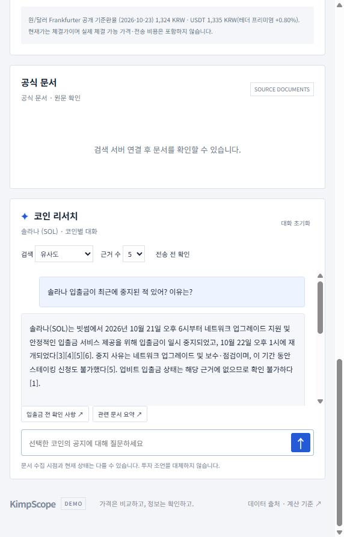 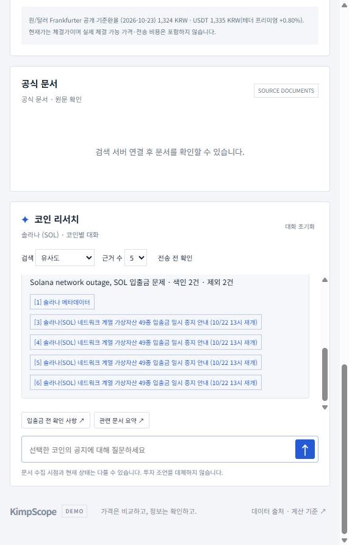

- 질문 "솔라나 입출금이 최근에 중지된 적 있어? 이유는?"에 대해 문장마다 [1][3]~[6] 번호를 붙여 답합니다. 빗썸 공지를 근거로 중지·재개 시점과 사유를 설명하고, "업비트 입출금 상태는 근거에 없으므로 확인 불가"라고 범위를 밝힙니다(F2007).
- 답변 아래(오른쪽 캡처)에 프롬프트 1이 뽑은 검색어, 프롬프트 2의 선별 결과(**색인 2건 · 제외 2건**), 실제 인용한 근거 목록이 나옵니다. 근거 목록의 번호는 본문에 쓰인 번호와 같습니다(F2003·F2004·F2008). [1]은 항상 선택 코인의 메타데이터입니다(F2006).
- 검색 방식(유사도 / MMR)과 근거 수(Top-k 3·5·8)를 채팅 위에서 바꿀 수 있습니다(F2006·F2014).

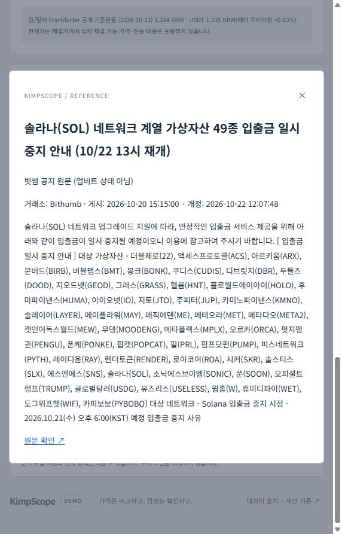 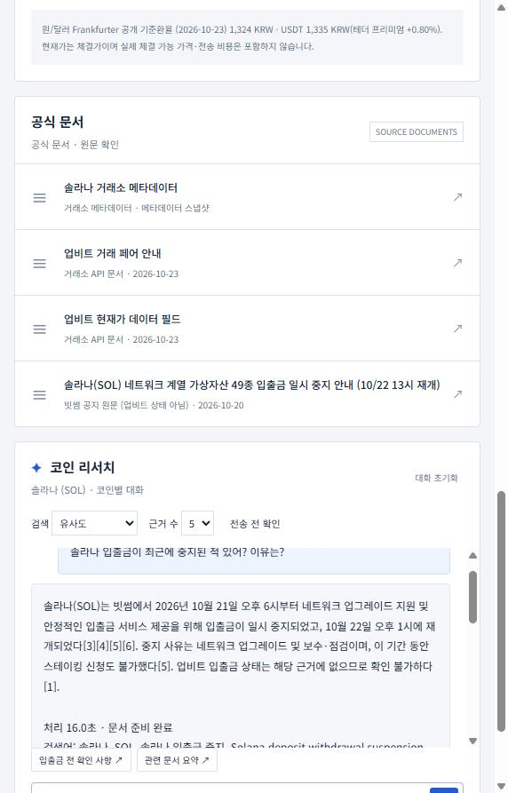

- 근거 번호를 누르면 원문 모달이 열립니다. 출처 종류("빗썸 공지 원문 (업비트 상태 아님)"), 거래소, 게시·개정 시각, 본문, 원문 링크를 보여 줍니다(F2016).
- 문서 패널은 이 코인에 연결된 문서를 종류(거래소 메타데이터 / 거래소 API 문서 / 빗썸 공지 원문)와 날짜로 나눠 보여 줍니다.

### 2-4. 코인별 대화 기록 분리 (F2009)

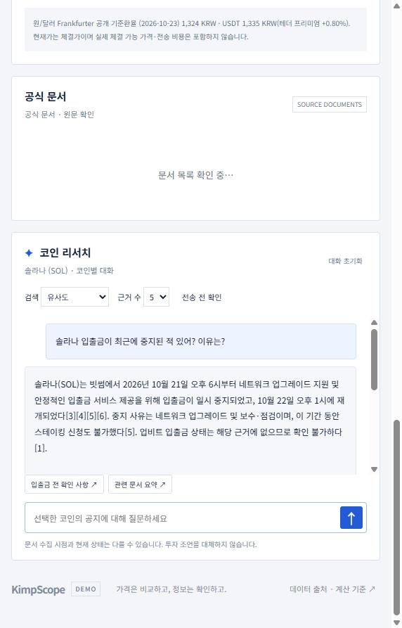

- 솔라나(SOL)에서 질문 → 비트코인(BTC)으로 바꿔 질문(2-5의 캡처) → 다시 솔라나로 돌아오면, 솔라나의 질문·답변만 남아 있고 비트코인 대화는 섞이지 않습니다. 새로고침한 뒤에도 코인별 기록이 유지됩니다. 돌아온 직후 화면의 대화 목록을 읽은 값은 [ui_history_switch.json](docs/checklist/evidence/ui_history_switch.json)에 있습니다.

### 2-5. 현재 김프 질문 — 실시간 근거 (F2007·F2008·F2010)

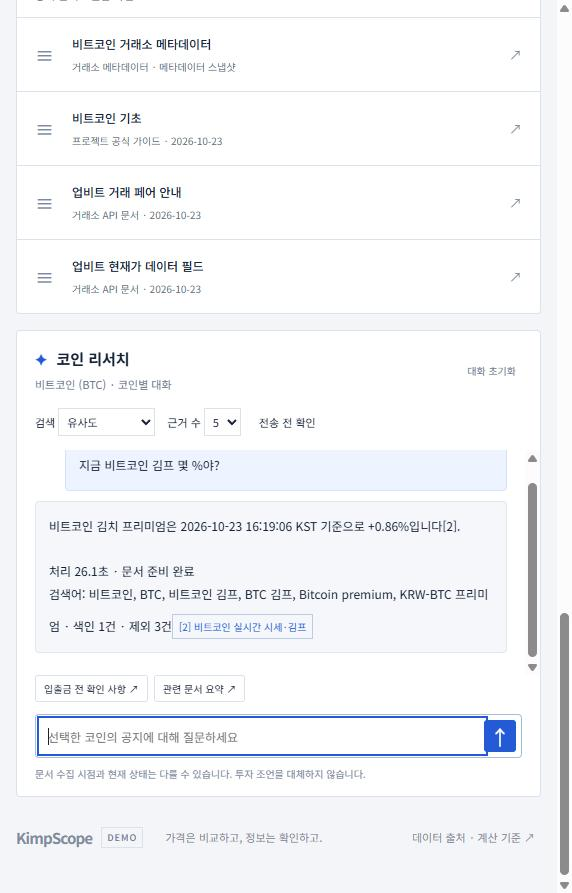

- "지금 비트코인 김프 몇 %야?"에 "2026-10-23 16:19:06 KST 기준 +0.86%[2]"로 답합니다. [2]는 질문 시점에 만든 "비트코인 실시간 시세·김프" 스냅샷입니다. 시세는 색인하지 않고 질문마다 새로 만들어 근거로 넣습니다.
- 문서 속 숫자를 현재 값으로 쓰지 않도록, 최신 스냅샷이 없으면 답하지 않고, 답변이 스냅샷을 인용하지 않으면 폐기합니다.

### 2-6. 진행 표시, 투자 판단 보류, 인용 없음 안내 (F2012)

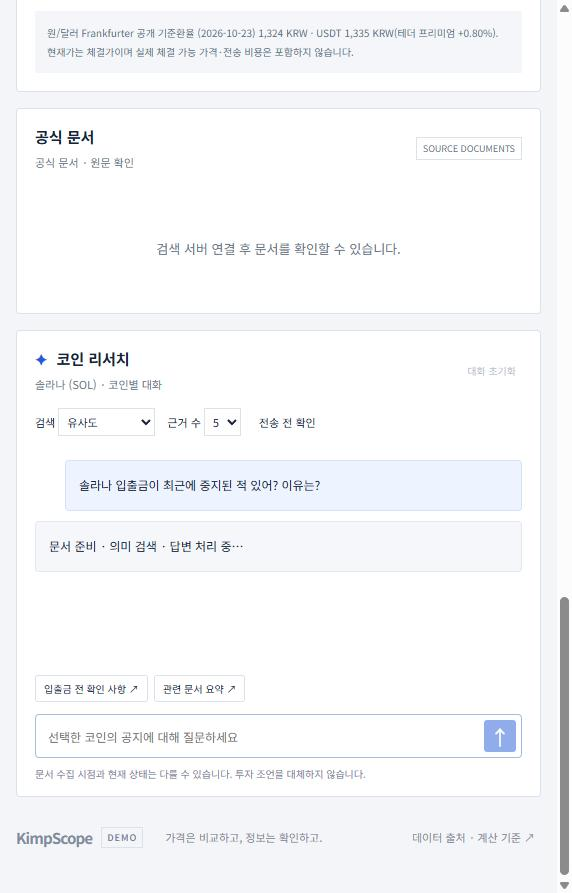 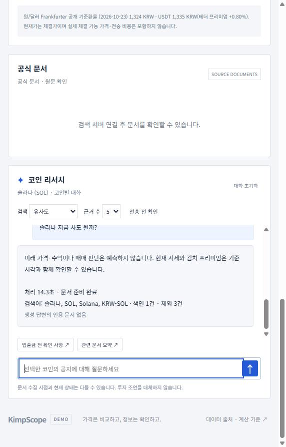

- 처리 중에는 "문서 준비 · 의미 검색 · 답변 처리 중…"을 표시하고, 전송 버튼과 "대화 초기화"가 흐리게 바뀝니다.
- "솔라나 지금 사도 될까?" 같은 매매 판단 질문은 예측하지 않는다고 답하고, 답변 아래에 "생성 답변의 인용 문서 없음"을 표시합니다(F2008).
- 입력창 아래에 "문서 수집 시점과 현재 상태는 다를 수 있습니다. 투자 조언을 대체하지 않습니다."를 항상 표시합니다(위험 도메인 안내).
- 색인이 없을 때("검색 색인이 없습니다. 데이터 색인을 먼저 실행하세요.")와 생성 키가 없을 때(검색 결과만 보여 주고 키 없음 안내)는 로컬 실행으로 확인했습니다([local_index.json](docs/checklist/evidence/local_index.json)). 운영 서버에서는 색인을 지우거나 키를 빼는 시험을 하지 않았습니다.

## 3. 요구사항별 충족 방법

필수 F2001~F2012와 선택 F2013~F2016을 모두 구현했습니다. "확인"은 셀프 체크리스트 번호이며, 결과와 증빙은 [docs/checklist/RESULTS.md](docs/checklist/RESULTS.md), 구현 위치까지 포함한 대조표는 [요구사항 정의서](docs/REQUIREMENTS.md)에 있습니다.

| ID | 요구사항 | 어떻게 충족했나 | 확인 |
| --- | --- | --- | --- |
| F2001 | 항목 메타데이터 약 100건 이상 | 업비트 KRW 마켓 298건을 코인마다 한 문장(한글명·영문명·심볼·거래 페어·유의 여부)으로 구성 | 1 (298 = 298) |
| F2002 | 색인, 재색인 중복 방지 | Chroma `items`에 마켓 코드를 고정 ID로 upsert | 2 (재실행 후 298 유지) |
| F2003 | 검색어 추출(프롬프트 1) | JSON 스키마로 검색어를 받고, 코인 이름·심볼을 항상 맨 앞에 붙임 | 3 (SOL 질문 검색어 6개) |
| F2004 | 수집·선별(프롬프트 2), 자체 문서 우선, 재수집 방지 | 선별 결과와 무관하게 자체 문서를 포함하고, 제외한 문서도 화면에 표시. 질문 캐시로 같은 질문은 다시 수집하지 않음 | 3·4 (색인 2 / 제외 2, 23.3초 → 13.8초) |
| F2005 | 별도 컬렉션, 덮어쓰지 않는 ID, 청크 설정 분리 | Chroma `documents`, 청크 ID `항목ID:문서ID:순번`, `CHUNK_SIZE`·`CHUNK_OVERLAP` 환경변수 | 5 (800/400/1200 → 7/15/5 청크) |
| F2006 | 메타데이터 항상 포함, 병합·중복 제거, Top-k | 메타데이터를 1번에 고정하고 같은 본문은 한 번만, `TOP_K` 3·5·8 | 6 (Top-k 3/8 → 문서 청크 2/5) |
| F2007 | LangGraph 두 노드, 근거만 사용, 확인 불가 응답 | `retrieve → generate`. 문서에 없으면 "제공된 근거에 없습니다" | 7·9 |
| F2008 | 실제 인용 근거만 표시 | 답변의 [번호]를 실제 근거와 대조하고, 없는 번호면 답변 폐기. 인용이 없으면 "인용 문서 없음" | 8·9 |
| F2009 | 항목 선택·코인별 대화 | 298개 중 선택, 코인마다 대화 기록 분리 | 10 |
| F2010 | 도메인 특화 기능 | 김프 시세표와, 실시간 김프·거래소 상태를 근거로 넣는 리서치 답변 | 12 |
| F2011 | 자연어 조건 탐색 | 조건을 스키마(심볼·유의 여부·이름)로 해석해 맞는 코인만 보여 주고 채팅으로 연결 | 11 |
| F2012 | 진행·오류·위험 도메인 안내 | 처리 중 표시, 색인 없음·키 없음 안내, 투자 조언 아님 안내, 예측 질문 보류 | 13·14 |
| F2013 | 직접 만든 프론트엔드 | `dist/`의 HTML·CSS·JS, FastAPI와 분리 | 15 |
| F2014 | MMR | 0.7 × 질문 유사도 − 0.3 × 이미 고른 청크와의 유사도 | 16 (4위 청크가 바뀜) |
| F2015 | RAG 전후 비교 | 대표 질문 5개를 근거 없이 / RAG로 실행해 비교 | 17·18 ([RAG_COMPARISON.md](docs/RAG_COMPARISON.md)) |
| F2016 | 복수 문서 출처 | 메타데이터·빗썸 공지·공식 문서·실시간 스냅샷을 결합하고 출처 종류를 표시 | 19 |
| NF2001~NF2007 | 응답 시간, 수집 캐시, 키 관리, 내부 정보 비노출, 모듈 분리, 호출 정책, 출처 기록 | 4절 구조의 모듈 분리, `.env`·환경변수로만 키 관리, 재시도·호출 간격·식별 User-Agent, [SOURCES.md](docs/SOURCES.md) | 20~24 |

## 4. 구조

```
                 ┌──────────────── 데이터 준비 ────────────────┐
업비트 마켓 목록 ─▶ 항목 텍스트 298건 ─▶ 임베딩 ─▶ Chroma "items"
빗썸 공지 21건(+본문) ─▶ Postgres(Neon) 보관·개정 이력 ─┐
공식 문서 7건(업비트 API 문서·bitcoin.org·ethereum.org·정부 보도자료 3) ─▶ Postgres ─┤ 질문 시 후보
                                                                      │
질문 ─▶ [프롬프트 1] 검색어 추출 ─▶ 후보 ─▶ [프롬프트 2] 선별 ─▶ 청킹·임베딩 ─▶ Chroma "documents"
                                     (질문 캐시: 같은 질문은 다시 수집하지 않음)

LangGraph:  retrieve ──────────────────────────────▶ generate
            ├ 선택 코인 메타데이터 (항상 1번)              [프롬프트 3] 근거만 사용, 문장마다 [번호]
            ├ 실시간 시세·김프 스냅샷 (색인 안 함)          ├ 인용 번호가 실제 근거에 있는지 검사
            ├ 거래소 입출금·경보 스냅샷 (색인 안 함)        ├ 현재 값 질문인데 실시간 근거를 인용 안 하면 폐기
            └ 외부 문서 검색 (유사도 또는 MMR, Top-k)     └ 예측·매매 판단 질문은 보류
```

| 모듈 | 책임 |
| --- | --- |
| `backend/catalog.py` | 항목 메타데이터 로드, 항목 텍스트 구성 (도메인 종속 부분) |
| `backend/collection.py` | 후보 문서 모음, 프롬프트 1·2, 질문 캐시 |
| `backend/store.py` | Chroma 두 컬렉션, 청킹·색인·재색인, 유사도/MMR 검색 |
| `backend/pipeline.py`, `prompts.py` | LangGraph 두 노드, 프롬프트 3, 인용 검사 |
| `backend/live.py` | 실시간 근거 생성, 현재 값 질문 분류 |
| `backend/market.py`, `fx.py` | 시세·김프·환율 |
| `backend/bithumb_notices.py`, `official_docs.py`, `exchange_status.py`, `notice_db.py` | 공지·공식 문서·거래소 상태 수집과 저장 |
| `backend/main.py` | API |
| `dist/` | 화면 (HTML·CSS·JS, F2013) |
| `scripts/cron_collect.py` | 15분 예약 수집 진입점 (GitHub Actions) |

### 주요 설계 결정

- **두 컬렉션.** `items`(코인 메타데이터)와 `documents`(외부 문서). 청크 ID는 `항목ID:문서ID:청크순번`이라 같은 공지가 여러 코인에 연결돼도 덮어쓰지 않습니다.
- **재색인 중복 방지.** 메타데이터는 고정 ID로 upsert. 외부 문서는 본문·청크 설정의 지문(SHA-256)이 같으면 건너뛰고, 바뀌면 이전 청크를 지운 뒤 다시 넣습니다. 청크 크기를 바꾸면 지문이 달라져 자동으로 다시 청킹됩니다.
- **항목 자체 문서 우선.** 프롬프트 2가 무엇을 고르든 선택 코인의 메타데이터 문서는 항상 색인·검색 결과 1번에 들어갑니다.
- **청크 설정.** `CHUNK_SIZE=800`, `CHUNK_OVERLAP=120`, `TOP_K=5` (환경변수로 변경). 빗썸 공지 본문은 371~5,523자(21건 실측)입니다. 800자 기준이면 짧은 공지는 1개, SOL 입출금 중지 공지는 5개 청크가 됩니다. 중복 120자(15%)는 "중지 시점 · 재개 시점"처럼 문단 경계에 걸친 문장이 양쪽 청크에 함께 남게 하는 여유입니다. 400/60으로 줄이면 같은 문서가 2배 넘게 잘게 나뉩니다(체크리스트 5번).
- **해외 가격.** 바이낸스 USDT 현물을 쓰고, 거래가 멈춘(BREAK) 심볼은 뺍니다. 거래가 멈춘 심볼에도 마지막 가격이 남아 있어 김프가 수천 %로 나오기 때문입니다(실측 DATA +16,826%). 바이낸스가 응답하지 않으면 OKX → Gate → Bybit 순으로 대체하고, 사용한 출처를 화면과 근거에 표시합니다. 운영 서버 IP가 바이낸스에서 418(IP 차단)을 받은 실제 장애에서 나온 구조입니다.
- **김프는 공식 환율 기준.** 업비트 USDT/KRW를 환율로 쓰면 테더 가격에 붙은 국내 프리미엄이 김프를 상쇄합니다(실측 BTC −0.01%). 수출입은행 매매기준율(키 필요) → Frankfurter 공개 기준환율 순으로 받고, 둘 다 실패하면 김프를 비워 둡니다. 고정 환율로 대체하지 않습니다.
- **서버에서 막힌 원문.** 빗썸 공지 본문 페이지는 Render 서버 요청에 403을 돌려줍니다. User-Agent를 브라우저로 위장해 우회하지 않고, 관리자가 브라우저로 받은 원본 HTML을 토큰이 있는 경로(`/api/admin/relay`)로 넘기면 서버가 같은 추출기로 본문을 뽑습니다. 이미 공식 목록 API로 받은 공지만 대상이며, 넘겨받은 본문에는 `body_via: browser_relay`가 붙습니다.
- **현재 값 질문은 두 번 막습니다.** 생성 전: 최신 실시간 근거가 없으면 모델을 부르지 않음. 생성 후: 답변이 그 근거를 인용하지 않으면 폐기(`live_citation_missing`). 문서 속 API 예시 가격을 현재가로 답한 실제 오류(2026-10-22)에서 나온 규칙입니다.

자세한 기록: [RAG 파이프라인 설계문서](docs/RAG_DESIGN.md) · [김프 계산과 실시간 근거](docs/LIVE_EVIDENCE.md) · [공지 수집 파이프라인](docs/NOTICE_PIPELINE.md) · [저장소 선택](docs/FREE_STORAGE_PLAN.md)

## 5. 실행

### Windows (PowerShell 7, Python 3.12)

```powershell
copy .env.example .env      # 이미 .env가 있으면 덮어쓰지 마세요
# .env에 OPENAI_API_KEY 입력 (SSAFY GMS 키)
pwsh -File scripts/run.ps1 -Setup   # 처음 한 번: 가상환경 생성 + 의존성 설치
pwsh -File scripts/run.ps1          # 실행 → http://127.0.0.1:4173
```

macOS/Linux: `python3.12 -m venv .venv && .venv/bin/pip install -r requirements.txt && sh scripts/run.sh`

처음 실행하면 시세표 위 상태 줄의 **데이터 색인**을 한 번 누른 뒤 질문합니다(메타데이터 298건 임베딩). 배포 환경은 시작 명령이 색인이 비어 있을 때 자동으로 만듭니다(`render.yaml`).

### 환경변수 (`.env`, Git에 올리지 않음)

| 이름 | 필수 | 설명 |
| --- | --- | --- |
| `OPENAI_API_KEY` | 예 | 생성·임베딩. 없으면 시세·조건 탐색·원문 조회만 동작하고 질문에는 키 없음 안내 |
| `OPENAI_BASE_URL` | 예 | SSAFY GMS 주소 (`.env.example`에 있음) |
| `CHAT_MODEL`, `EMBED_MODEL` | 아니오 | 기본 `gpt-4.1-mini`, `text-embedding-3-small` |
| `CHUNK_SIZE`, `CHUNK_OVERLAP`, `TOP_K` | 아니오 | 기본 800, 120, 5 |
| `DATABASE_URL` | 아니오 | 공지·상태 저장용 PostgreSQL. 없으면 로컬 SQLite |
| `KOREAEXIM_API_KEY` | 아니오 | 수출입은행 환율. 없으면 Frankfurter |

## 6. 검증

```powershell
.\.venv\Scripts\python.exe -m pytest -q          # 외부 호출 없음
.\.venv\Scripts\python.exe -m scripts.checklist_local   # F2001·F2002·F2005·F2007·F2012 (임베딩 스텁)
node scripts/checklist_api.mjs https://kimpscope.onrender.com   # 운영 API로 나머지 항목 (모델 호출 발생)
```

### 2026-10-23 셀프 점검 결과 — 통과 26 · 실패 1 / 27

운영 서버에서 직접 실행한 값입니다(청크 설정 비교와 자동 테스트는 로컬 실행). 항목별 증빙(실행 결과 JSON, 화면 캡처 11장)은 [docs/checklist/RESULTS.md](docs/checklist/RESULTS.md)에 있습니다.

| 확인한 것 | 결과 |
| --- | --- |
| 메타데이터 로드 = 색인, 재색인 | 298 = 298, 재실행 후 298 |
| 검색어·선별 (SOL 질문) | 검색어 6개, 색인 2건 / 제외 2건 |
| 같은 질문 재실행 | 수집 캐시 사용(프롬프트 1·2 생략), 23.3초 → 13.8초 |
| 청크 설정 800 / 400 / 1200 (로컬, 임베딩 스텁) | 청크 7 / 15 / 5 |
| Top-k 3 / 8, 유사도 / MMR | 문서 청크 2 / 5, MMR이 4위 청크를 다른 청크로 교체 |
| 문서에 없는 질문 | "제공된 근거에 없습니다" |
| 현재 김프 질문 | 기준 시각과 +0.87%를 실시간 스냅샷 인용으로 답함 |
| 투자 판단 질문 | 보류, 화면에 "인용 문서 없음" 표시 |
| 자동 테스트 | 점검 당시 67개 통과. 이후 정부 보도자료 수집 테스트를 더해 현재 72개 통과 ([테스트 결과표](docs/TEST_RESULTS.md)) |

실패 1건은 27번입니다. 요구사항 정의서와 RAG 파이프라인 설계문서는 추가했고, 상호 체크리스트가 아직 없습니다. 점검 중 발견해 고친 문제 5건은 RESULTS.md 끝에 있습니다.

## 7. 문서 목록

| 문서 | 내용 |
| --- | --- |
| [docs/REQUIREMENTS.md](docs/REQUIREMENTS.md) | 요구사항 정의서: 도메인 조건 충족 근거, 필수·선택·비기능 요구사항별 구현과 확인 결과 |
| [docs/RAG_DESIGN.md](docs/RAG_DESIGN.md) | RAG 파이프라인 설계문서: 컬렉션·메타데이터·청크 ID, 수집·선별·청킹, 프롬프트 3개, 설정값과 변경 결과, 실시간 근거 규칙, 겪은 문제 |
| [docs/checklist/RESULTS.md](docs/checklist/RESULTS.md) | 셀프 체크리스트 27개 항목 결과·증빙 (엑셀 기입본과 원본도 같은 폴더) |
| [docs/TEST_RESULTS.md](docs/TEST_RESULTS.md) | 자동 테스트 결과표와 요구사항 대응 |
| [docs/RAG_COMPARISON.md](docs/RAG_COMPARISON.md) | RAG 전후 답변 비교 (F2015) |
| [docs/LIVE_EVIDENCE.md](docs/LIVE_EVIDENCE.md) | 김프 계산 기준, 실시간 근거 규칙, 배포 후 발견한 장애와 조치 |
| [docs/SOURCES.md](docs/SOURCES.md) | 데이터 출처·호출 정책·이용 조건 |
| [docs/NOTICE_PIPELINE.md](docs/NOTICE_PIPELINE.md) | 공지 수집·개정 이력 설계 |

## 8. 데이터 출처와 이용 조건

[docs/SOURCES.md](docs/SOURCES.md)에 출처별 주소·키 필요 여부·호출 정책·이용 조건을 정리했습니다. 확인하지 못한 조건은 미확인으로 적었습니다. 이 저장소는 교육용 시연 범위로 운영합니다.

## 9. 한계

- 입출금 상태와 공지는 **빗썸 기준**입니다. 업비트 입출금 현황·공지는 API 키가 필요해 수집하지 못했고, 답변에 "빗썸 기준"을 밝힙니다.
- 원/달러는 고시 환율이라 고시 이후 환율 변동분이 김프에 섞입니다. 화면과 근거에 고시일을 표시합니다.
- 현재 값 질문 분류는 정규식입니다. 우회 표현을 모두 잡지는 못하고, 생성 후 인용 판정이 두 번째 방어선입니다.
- 빗썸 공지 API는 최근 20건만 줍니다. 예약 수집이 시작된 이후의 공지만 쌓입니다.
- 새 빗썸 공지는 서버가 본문을 받지 못합니다(403). 관리자 브라우저 경유가 다시 필요합니다.
- 15분 예약 수집(GitHub Actions)은 2026-10-23 16:55 KST 수동 실행에서 처음 운영 DB에 기록했습니다. 예약 실행이 이어지는지는 아직 확인하지 않았습니다. 상태 수집이 45분 넘게 끊기면 입출금·경보 상태 질문은 근거 없음으로 거절됩니다.
- Render 무료 플랜은 디스크가 재배포마다 비워집니다. Chroma 색인은 시작할 때 다시 만들고, 공지·상태는 외부 PostgreSQL에 둡니다.
